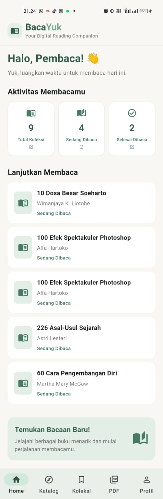
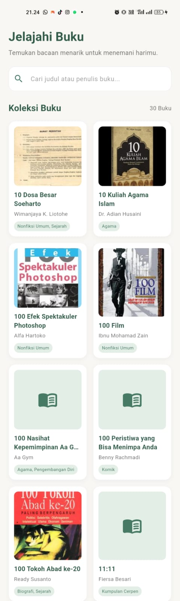
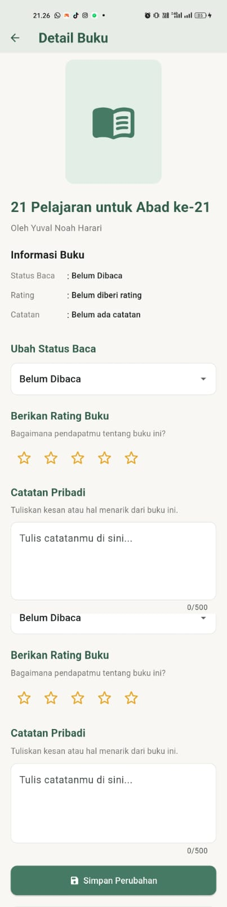
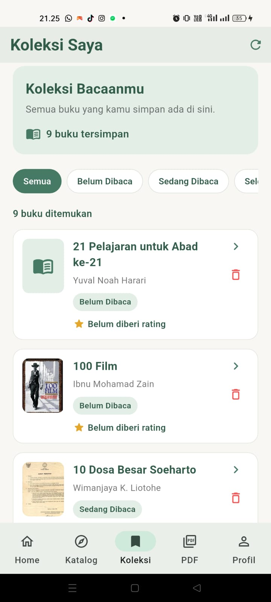
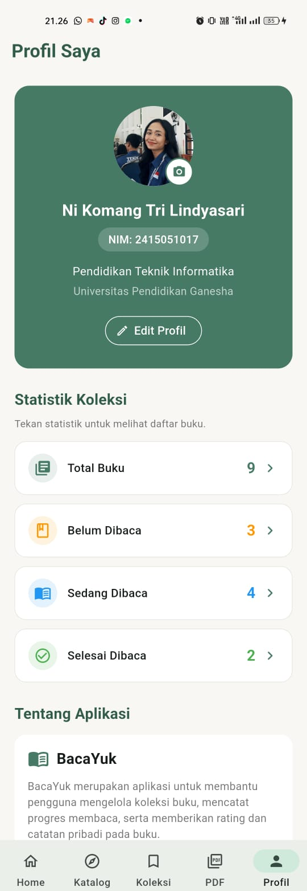
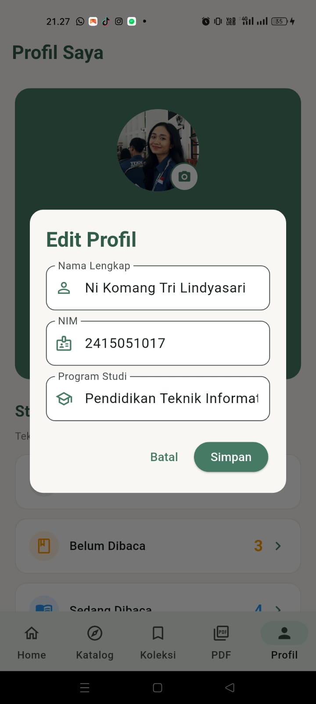
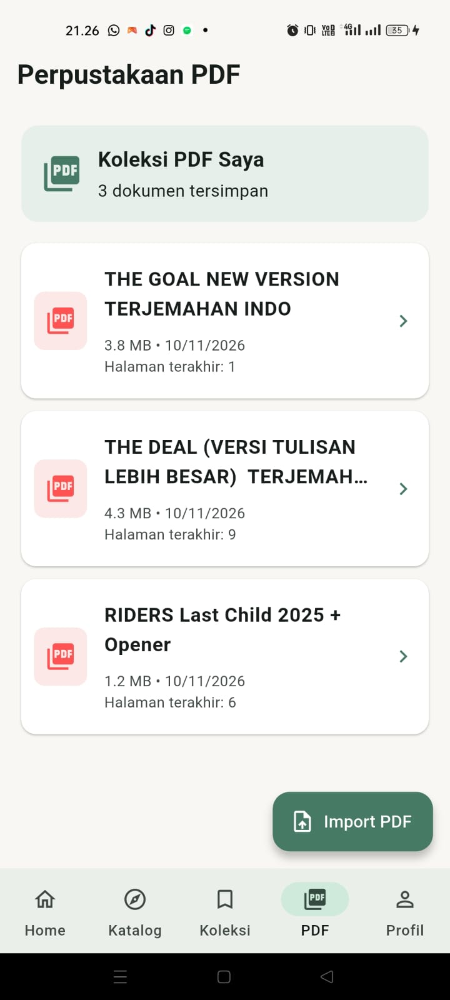
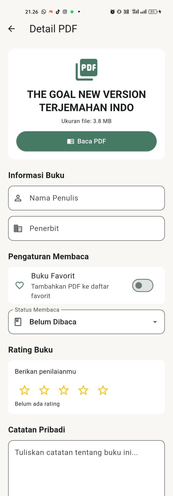

# BacaYuk 📚

**BacaYuk** merupakan aplikasi mobile berbasis Flutter yang dikembangkan untuk membantu pengguna mengelola koleksi buku dan memantau aktivitas membaca. Aplikasi ini menyediakan katalog buku, informasi detail buku, pengelolaan koleksi pribadi, serta fitur membaca dan mengelola dokumen PDF.

## Identitas Pengembang

| Keterangan | Detail |
|---|---|
| Nama | Ni Komang Tri Lindyasari |
| NIM | 2415051017 |
| Program Studi | Pendidikan Teknik Informatika |
| Fakultas | Teknik dan Kejuruan |
| Universitas | Universitas Pendidikan Ganesha |
| Mata Kuliah | Pemrograman Berbasis Mobile |

## Fitur Aplikasi

1. **Home** – Menampilkan ringkasan koleksi buku, statistik membaca, dan buku yang terakhir dibaca.
2. **Katalog Buku** – Menampilkan daftar buku dari REST API beserta informasi dan sampul buku.
3. **Detail Buku** – Menampilkan informasi buku dan menyediakan fitur menambahkan buku ke koleksi.
4. **Koleksi Buku** – Mengelola buku pribadi, termasuk melihat, mengubah status membaca, memberikan rating, dan menambahkan catatan.
5. **Hapus Buku** – Menghapus buku dari koleksi dengan konfirmasi.
6. **PDF Library** – Menampilkan dan mengelola daftar dokumen PDF.
7. **PDF Reader** – Membuka dan membaca dokumen PDF.
8. **Profil** – Menampilkan dan mengubah informasi profil serta foto profil.
9. **Progress Membaca** – Menampilkan perkembangan aktivitas membaca.

## Teknologi yang Digunakan

- **Flutter** – Framework pengembangan aplikasi.
- **Dart** – Bahasa pemrograman.
- **Provider** – State management.
- **Supabase** – Backend database dan autentikasi.
- **REST API** – Mengambil data buku dari layanan eksternal.
- **HTTP** – Melakukan komunikasi dengan REST API.
- **Shared Preferences** – Penyimpanan data lokal.
- **Image Picker** – Memilih foto profil dari perangkat.
- **Syncfusion PDF Viewer** – Menampilkan dokumen PDF.

## REST API

Aplikasi menggunakan REST API dari:

`https://khrlanamm.github.io/buku-indonesia/api/v1/search-index.json`

API digunakan untuk mengambil data buku, seperti:
- ID buku
- Judul buku
- Penulis
- Penerbit
- Tahun terbit
- ISBN
- Kategori
- Sampul buku

Data JSON diolah menjadi objek Dart menggunakan model `Book`.

## Database

Aplikasi menggunakan **Supabase** sebagai backend database.

Tabel utama yang digunakan adalah `saved_books`, yang menyimpan data buku milik pengguna.

Operasi database meliputi:

- **Create:** Menambahkan buku ke koleksi.
- **Read:** Mengambil dan menampilkan koleksi buku.
- **Update:** Memperbarui status membaca, rating, dan catatan.
- **Delete:** Menghapus buku dari koleksi.

Aplikasi juga menggunakan autentikasi anonim Supabase untuk mengidentifikasi pengguna.

## Arsitektur Project

Struktur direktori utama:

```text
lib/
├── main.dart
├── models/
├── services/
├── repositories/
├── providers/
├── screens/
├── widgets/
├── pdf/
│   ├── models/
│   ├── providers/
│   ├── repositories/
│   └── screens/
└── utils/
```

Penerapan arsitektur aplikasi menggunakan pemisahan tanggung jawab:

- **Models:** Mengelola struktur dan representasi data.
- **Services:** Menangani komunikasi dengan REST API.
- **Repositories:** Mengelola sumber dan operasi data.
- **Providers:** Mengelola state aplikasi menggunakan Provider.
- **Screens:** Menampilkan halaman aplikasi.
- **Widgets:** Menyediakan komponen antarmuka yang dapat digunakan kembali.

## Tampilan Aplikasi

Tambahkan screenshot aplikasi pada bagian berikut:

## Tampilan Aplikasi

### 1. Home


### 2. Katalog Buku


### 3. Detail Buku


### 4. Koleksi Buku


### 5. Profil


### 6. Edit Profil


### 7. Perpustakaan PDF


### 8. PDF Reader


## Cara Menjalankan Aplikasi

### 1. Clone Repository

```bash
git clone origin  https://github.com/Lindyasari/UTS_2415051017_NiKomangTriLindyasari.git (fetch)
origin  https://github.com/Lindyasari/UTS_2415051017_NiKomangTriLindyasari.git (push)
```

### 2. Masuk ke Direktori Project

```bash
cd bacayuk
```

### 3. Install Dependencies

```bash
flutter pub get
```

### 4. Jalankan Aplikasi

```bash
flutter run
```

Pastikan Flutter SDK telah terpasang dan perangkat Android atau emulator sudah terhubung.

## Tujuan Pengembangan

Aplikasi BacaYuk dikembangkan sebagai bagian dari pemenuhan tugas Ujian Tengah Semester mata kuliah Pemrograman Mobile. Pengembangan aplikasi ini bertujuan untuk menerapkan konsep pengembangan aplikasi mobile menggunakan Flutter, REST API, database, state management, navigasi, dan desain antarmuka responsif.

---

**BacaYuk – Mulai membaca, kelola koleksi, dan pantau progres membaca!**